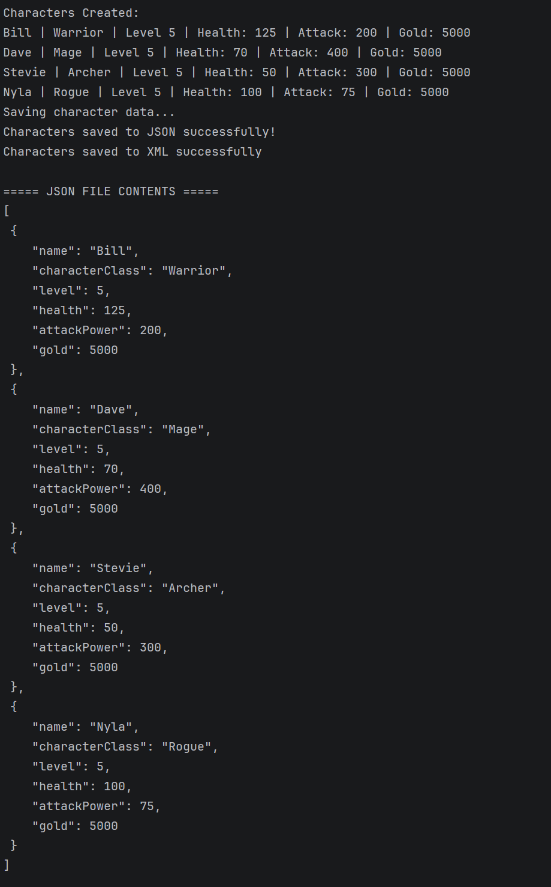
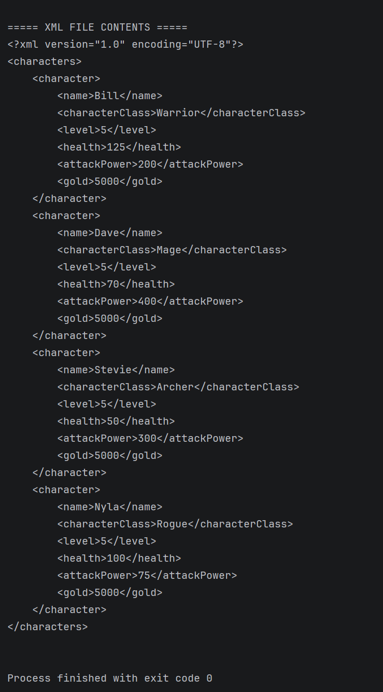

# Video Game Character Save Files
## Project Description
This Java application demonstrates how to save and read video game character data using JSON
and XML file formats. The program creates four game characters with different classes and attributes, stores
them in a list, and saves their information to two separate files.

After saving the files, the program reads their contents and displays them in the console.

<strong>Project Features</strong>

## Project Features

- Creates four game characters: Bill (Warrior), Dave (Mage), Stevie (Archer), and Nyla (Rogue).
- Stores character information using a GameCharacter class.
- Uses an ArrayList to manage multiple characters.
- Converts character attributes into key-value pairs using a toDict() method.
- Saves character data to characters.json and characters.xml.
- Reads both files and displays their contents in the console.
- Uses exception handling to manage file input/output errors.

<strong>Character Attributes</strong>

## Character Attributes

Each character contains six attributes:
- Name: The character's name.
- Character Class: The character's role or type.
- Level: The character's current level.
- Health: The character's health points.
- Attack Power: The character's attack strength.
- Gold: The amount of gold the character possesses.

<strong>Project Files</strong>

## Project Files

| File | Description |
|---|---|
| `GameCharacter.java` | Defines the character attributes, constructor, getters, and conversion methods. |
| `CharacterJsonWriter.java` | Saves character data in JSON format. |
| `CharacterXmlWriter.java` | Saves character data in XML format. |
| `Main.java` | Creates characters, saves files, and reads their contents. |
| `characters.json` | Generated JSON character data. |
| `characters.xml` | Generated XML character data. |
| `pom.xml` | Maven project configuration. |

<strong>Requirements</strong>

## Requirements

- Java 26
- A Java IDE such as IntelliJ IDEA
- Maven

<strong>How to Run</strong>

## How to Run

1. Clone or download the GitHub repository.
2. Open the project in IntelliJ IDEA.
3. Allow Maven to load the project configuration.
4. Open Main.java in the com.charactersavefiles package.
5. Run the main() method.
6. Check the console for the save confirmation messages and the contents of both files.

<strong>JSON vs. XML</strong>

## JSON vs. XML

JSON stores data using key-value pairs and arrays, while XML uses opening and closing tags to organize information.

Both formats can represent the same character attributes, but JSON is generally more compact
because it does not require a closing tag for every field. XML is more repetitive, although its tags
make the structure and relationships between elements clear.

In this project, both formats successfully store the same character information.

<strong>Error Handling</strong>

## Error Handling

The application uses a try/catch block to handle IOException errors that may occur while saving or
reading files. If a file operation fails, the program displays an error message rather than terminating with
an unhandled exception.

<strong>Conclusion</strong>

## Conclusion

This project demonstrates Java object-oriented programming, collections, file input/output, exception
handling, and structured data storage. It also provides a practical comparison of JSON and XML for
saving video game character information.

<strong>Screenshots</strong>

## Screenshots

### Program Output - Part 1

### Program Output - Part 2

